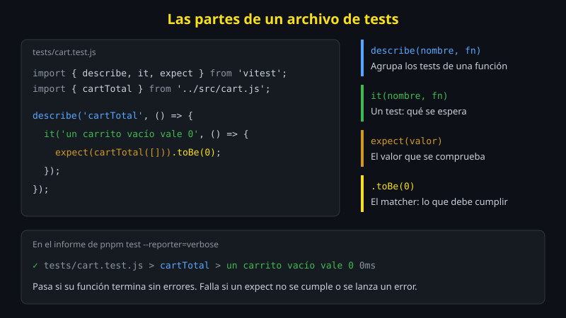

# ⚡ Vitest

## 🎯 Objetivos

- Crear un `package.json` con pnpm y entender sus campos.
- Instalar Vitest como dependencia de desarrollo con una versión exacta, y saber para qué sirve `pnpm-lock.yaml`.
- Escribir un archivo de tests con `describe`, `it` y `expect`.
- Ejecutar los tests una vez o en modo watch, y elegir cuáles.
- Leer el informe de un test que falla.

Hasta la semana 24 los proyectos no tenían dependencias: JavaScript del navegador y de Node, sin instalar nada. **Vitest** es la primera. Es un framework de tests que entiende los módulos ES sin configurar nada, es rápido y usa la misma forma de escribir tests que Jest, el framework más extendido. Lo que aprendas aquí te sirve en los dos.

---

## 📋 Contenido

### 1. El package.json

Un proyecto con dependencias tiene un `package.json` en su raíz: su nombre, sus scripts y lo que necesita instalar. Se crea con:

```bash
pnpm init
```

Los campos que importan esta semana, tal como quedan en los proyectos de la semana:

```json
{
  "name": "tests-del-catalogo",
  "version": "1.0.0",
  "private": true,
  "type": "module",
  "scripts": {
    "test": "vitest run",
    "coverage": "vitest run --coverage"
  },
  "engines": {
    "node": ">=24"
  },
  "packageManager": "pnpm@12.20.0",
  "devDependencies": {
    "@vitest/coverage-v8": "5.1.0",
    "vitest": "5.1.0"
  }
}
```

| Campo | Qué es | Para qué |
|---|---|---|
| `type: "module"` | Los `.js` son módulos ES | `import`/`export` sin cambiar la extensión a `.mjs` |
| `private: true` | El paquete no se publica | Evita subirlo por error al registro de paquetes |
| `scripts` | Comandos con nombre | `pnpm test` ejecuta `vitest run`; `pnpm coverage`, la cobertura |
| `engines.node` | La versión mínima de Node | Avisa si alguien lo ejecuta con un Node antiguo |
| `packageManager` | La versión de pnpm del proyecto | Todos usan el mismo pnpm. `pnpm init` lo escribe junto con `devEngines` |
| `devDependencies` | Lo que hace falta para desarrollar, no para ejecutar la página | Los tests no llegan nunca al navegador de quien usa la página |

`pnpm init` escribe en `packageManager` la versión de pnpm más reciente que conoce. En los labs la cambias por la del curso, la de [docs/stack-versions.md](../../../docs/stack-versions.md).

### 2. Instalar con una versión exacta

```bash
pnpm add -D --save-exact vitest@5.1.0
```

- `-D` (`--save-dev`) la guarda en `devDependencies`.
- `vitest@5.1.0` pide esa versión. Sin `@`, pnpm instalaría la más reciente.
- `--save-exact` escribe `"5.1.0"` en lugar de `"^5.1.0"`. Con `^`, otra instalación podría traer una 5.2 o una 5.9.

**Por qué una versión exacta y no la última:** de vez en cuando alguien consigue publicar una versión maliciosa de un paquete conocido, y la retiran a los pocos días. Quien instala «la última» en ese intervalo se la lleva. Una versión exacta, con al menos una semana publicada, evita ese riesgo; la del curso cumple las dos cosas.

La instalación crea dos cosas más:

- **`node_modules/`**: Vitest y las 34 dependencias que trae. No se sube a git. Se recrea con `pnpm install`.
- **`pnpm-lock.yaml`**: la versión exacta de **cada** paquete instalado, también de las dependencias de Vitest. Sí se sube a git: con él, `pnpm install` en otro equipo instala exactamente lo mismo.

En los labs 02 a 04 y en el proyecto, el `package.json` y el `pnpm-lock.yaml` ya vienen hechos. Solo ejecutas `pnpm install`.

### 3. Dónde van los tests

Vitest busca él solo los archivos que terminan en `.test.js` (o `.spec.js`), en cualquier carpeta salvo `node_modules/`. En el bootcamp van en una carpeta `tests/`, separados del código:

```text
proyecto/
├── package.json
├── pnpm-lock.yaml
├── src/
│   └── cart.js
└── tests/
    └── cart.test.js
```

Como `tests/` y `src/` son hermanas, los tests importan con `../src/`.

### 4. Anatomía de un test

```js
import { describe, it, expect } from 'vitest';
import { cartTotal } from '../src/cart.js';

describe('cartTotal', () => {
  it('suma el importe de todas las líneas', () => {
    expect(cartTotal([{ price: 12.5, quantity: 2 }, { price: 3, quantity: 1 }])).toBe(28);
  });

  it('un carrito vacío vale 0', () => {
    expect(cartTotal([])).toBe(0);
  });
});
```



- **`describe(nombre, función)`** agrupa tests. Normalmente, uno por función que se prueba.
- **`it(nombre, función)`** es un test. Su nombre completa la frase: «cartTotal… suma el importe de todas las líneas». `test` es otro nombre para lo mismo, y verás los dos.
- **`expect(valor)`** envuelve el valor que se comprueba, y un **matcher** como `.toBe(28)` dice qué debe cumplir ([teoría 03](03-matchers.md)).
- Un test **pasa** si su función termina sin errores y **falla** si algún `expect` no se cumple o se lanza cualquier error.

`describe`, `it` y `expect` se importan de `'vitest'`. Vitest puede hacerlos globales con una opción, pero importarlos deja claro de dónde salen.

### 5. Ejecutar los tests

| Comando | Qué hace |
|---|---|
| `pnpm test` | Ejecuta `vitest run`: todos los tests una vez, y termina |
| `pnpm test cart` | Solo los archivos cuya ruta contiene `cart` |
| `pnpm test -t "vacío"` | Solo los tests cuyo nombre contiene `vacío` |
| `pnpm test --reporter=verbose` | Escribe cada test con su nombre, no solo los que fallan |
| `pnpm vitest` | **Modo watch**: ejecuta los tests y se queda esperando; cada vez que guardas un archivo, repite los tests afectados. `q` para salir |

Lo que va detrás de `pnpm test` se le pasa a `vitest run`. Si todo pasa, el comando termina con código 0; si algo falla, con 1. Así lo usan `scripts/verificar-semana.sh` y los servicios de integración continua, que ejecutan los tests en cada cambio que se sube al repositorio.

Un informe cuando todo pasa, con `--reporter=verbose`, del [lab 01](../2-practicas/lab-01-primer-test/README.md#paso-4-el-primer-test):

```text
 RUN  v5.1.0 …/lab-01-primer-test/starter

 ✓ tests/cart.test.js > cartTotal > suma el importe de todas las líneas 1ms
 ✓ tests/cart.test.js > cartTotal > un carrito vacío vale 0 0ms

 Test Files  1 passed (1)
      Tests  2 passed (2)
   Start at  03:16:27
   Duration  112ms (import 44%, transform 26%, worker 16%, tests 13%)
```

### 6. Leer un test que falla

```text
 FAIL  tests/cart.test.js > lineTotal > multiplica el precio por la cantidad
AssertionError: expected 25 to be 24 // Object.is equality

- Expected
+ Received

- 24
+ 25

 ❯ tests/cart.test.js:23:33
     21| describe('lineTotal', () => {
     22|   it('multiplica el precio por la cantidad', () => {
     23|     expect(lineTotal(lines[0])).toBe(24);
       |                                 ^
```

1. **Qué test:** archivo `>` `describe` `>` `it`.
2. **Qué pasó:** `expected 25 to be 24`. Lo primero es lo que salió, lo segundo lo que se esperaba.
3. **La diferencia:** `-` para lo esperado (`Expected`) y `+` para lo recibido (`Received`). Con objetos grandes, solo se marcan las líneas distintas.
4. **Dónde:** archivo, línea y columna, con el código alrededor.

Antes de cambiar nada, decide **quién tiene razón**: el test o el código. En el lab 01, el test esperaba 24 y 12,5 × 2 son 25. El error estaba en el test.

### 7. vitest.config.js

Vitest funciona sin configuración. Cuando hace falta cambiar algo, se escribe en `vitest.config.js`, junto al `package.json`:

```js
import { defineConfig } from 'vitest/config';

export default defineConfig({
  test: {
    coverage: {
      include: ['src/**/*.js'],
    },
  },
});
```

`defineConfig` no hace nada con el objeto; solo ayuda al editor a sugerir las opciones. Esta semana solo se configura la cobertura ([teoría 05](05-cobertura.md)).

---

## 🧪 Pruébalo

En los pasos 3 a 6 del [lab 01](../2-practicas/lab-01-primer-test/README.md) creas el `package.json`, instalas Vitest, escribes el primer test, lees un fallo y encuentras un error.

## ✅ Checklist de aprendizaje

- [ ] Creo un `package.json` con `pnpm init` y explico `type`, `scripts`, `packageManager` y `devDependencies`.
- [ ] Instalo una dependencia de desarrollo con una versión exacta y explico por qué.
- [ ] Explico qué guardan `node_modules/` y `pnpm-lock.yaml`, y cuál se sube a git.
- [ ] Escribo un archivo de tests con `describe`, `it` y `expect`.
- [ ] Ejecuto todos los tests, solo unos archivos o solo unos nombres, y uso el modo watch.
- [ ] Leo un fallo de Vitest: qué test, qué salió, qué se esperaba y dónde.

<!-- nav -->
---

## 🔗 Navegación

| Anterior | Siguiente |
|---|---|
| ← [Teoría — 🧪 Por qué escribir tests](01-por-que-tests.md) | [Teoría — 🎯 Matchers](03-matchers.md) → |

[↑ Semana 25](../README.md)
