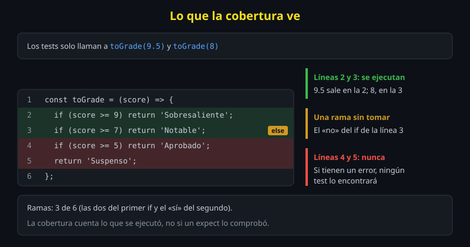

# 📊 Cobertura

## 🎯 Objetivos

- Explicar qué mide la cobertura de tests y qué no.
- Leer las cuatro medidas: sentencias, ramas, funciones y líneas.
- Generar el informe con `@vitest/coverage-v8` en la terminal y en el navegador.
- Incluir los archivos que ningún test importa y fijar umbrales.
- Entender por qué un 100 % de cobertura no garantiza buenos tests, y qué es un mutante.

Con los tests escritos, queda una pregunta: ¿qué parte del código prueban? La cobertura responde a una parte de esa pregunta. La otra parte, si los tests **comprueban** bien lo que ejecutan, no la mide nadie salvo tú.

---

## 📋 Contenido

### 1. Qué es la cobertura

Mientras se ejecutan los tests, Vitest apunta qué partes del código se ejecutan. La **cobertura** es el porcentaje de código que se ejecutó al menos una vez. Lo que nunca se ejecutó durante los tests es código sin probar: si tiene un error, ningún test lo encontrará.



### 2. Las cuatro medidas

| Medida | Cuenta | Ejemplo en `toGrade` |
|---|---|---|
| **Statements** (sentencias) | Cada instrucción: un `return`, un `throw`, una asignación | `return 'Notable'` |
| **Branches** (ramas) | Cada camino posible de un `if`/`else`, un `? :`, un `&&`, un `||` o un `??` | El `if (score >= 7)` tiene dos: se cumple o no |
| **Functions** (funciones) | Cada función, también las flechas que se pasan a `map` o `reduce` | `toGrade`, `average` y la flecha de su `reduce` |
| **Lines** (líneas) | Cada línea que tiene código | La línea 7 |

Las **ramas** son la medida que más dice. Una función con un `if` puede tener sus líneas cubiertas con un solo test, que nunca entra en el `else`. En el [lab 04](../2-practicas/lab-04-cobertura/README.md#paso-1-el-primer-informe), dos tests dejan las funciones al 100 % y las ramas al 46 %:

```text
-----------|---------|----------|---------|---------|-------------------
File       | % Stmts | % Branch | % Funcs | % Lines | Uncovered Line #s
-----------|---------|----------|---------|---------|-------------------
All files  |   53.84 |    46.15 |     100 |   57.14 |
 grades.js |   53.84 |    46.15 |     100 |   57.14 | 7-9
-----------|---------|----------|---------|---------|-------------------
```

`Uncovered Line #s` lista las líneas que ningún test ejecutó. Una rama sin cubrir en una línea que sí se ejecutó no sale ahí; se ve en el informe HTML.

### 3. Generar el informe

La cobertura necesita un paquete aparte, en **la misma versión** que Vitest:

```bash
pnpm add -D --save-exact @vitest/coverage-v8@5.1.0
```

`v8` es el motor de JavaScript de Node y de Chrome: él mismo cuenta qué se ejecuta, y Vitest solo lee sus cuentas. Para que siempre midan lo mismo, los proyectos de la semana configuran `vitest.config.js` así:

```js
import { defineConfig } from 'vitest/config';

export default defineConfig({
  test: {
    coverage: {
      include: ['src/**/*.js'],
      reporter: ['text', 'html'],
    },
  },
});
```

- **`include`:** sin él, solo cuentan los archivos que algún test importa. Un archivo sin ningún test no aparecería, justo el que más lo necesita. Con `include`, sale con un 0 %.
- **`reporter`:** `text` es la tabla de la terminal y `html` crea `coverage/index.html`. Si no lo indicas, Vitest también escribe otros formatos para herramientas externas.

Se ejecuta con `vitest run --coverage`, que en los proyectos es el script `pnpm coverage`. El informe HTML se abre con doble clic. Las líneas sin ejecutar salen en rojo, una **I** o una **E** marcan el `if` o el `else` que nunca se tomó, y a la izquierda de cada línea se ve cuántas veces se ejecutó. La carpeta `coverage/` se vuelve a crear en cada ejecución y no se sube a git.

Cuando un archivo está cubierto al 100 %, la tabla ya no lo enseña. Si todos lo están, solo dice:

```text
No files with missing coverage.
2 files fully covered.
```

### 4. Umbrales

Un **umbral** es la cobertura mínima. Si no se alcanza, el comando falla aunque todos los tests pasen:

```js
coverage: {
  include: ['src/**/*.js'],
  thresholds: { lines: 90, branches: 90, functions: 90, statements: 90 },
},
```

```text
ERROR: Coverage for lines (87.5%) does not meet global threshold (90%)
ERROR: Coverage for functions (60%) does not meet global threshold (90%)
ERROR: Coverage for statements (81.25%) does not meet global threshold (90%)
```

También se pueden pasar en el comando, como hacen las comprobaciones del proyecto: `vitest run --coverage --coverage.thresholds.100` exige el 100 % en las cuatro medidas. Así, quien añada código sin tests se entera en el momento, y no meses después, cuando ese código falle.

### 5. Lo que la cobertura no mide

Este test cubre `formatReport` al 100 %:

```js
it('formatReport', () => {
  formatReport([5, 9]);
});
```

No tiene ningún `expect`. Pasa diga lo que diga `formatReport`. La cobertura cuenta qué código **se ejecutó**, no qué código **se comprobó**. Tampoco sabe si probaste los límites: con los tests del lab 04 (9,5, 8, 6, 2 y tres valores no válidos), `toGrade` está cubierta al 100 %, y cambiar `score >= 9` por `score > 9` no rompe ninguno.

Para saber si los tests detectan errores, hay que **introducir errores a propósito** y ver si algún test falla. Cada versión rota del código es un **mutante**:

| Cambio en el código | ¿Algún test falla? | |
|---|---|---|
| `score >= 9` por `score > 9` | No, con 9,5 da igual | El mutante **sobrevive**: falta el test del 9 |
| `.join('\n')` por `.join(', ')` | No, el test no tiene `expect` | Sobrevive: el test no comprueba nada |
| `toSorted` por `sort` | Sí, si un test mira el array original | El mutante **muere**: ese test protege |

Hay herramientas que crean cientos de mutantes y cuentan cuántos sobreviven. Las comprobaciones del proyecto de esta semana hacen lo mismo a pequeña escala: rompen `src/logic.js` de siete formas distintas y exigen que tus tests fallen con cada una.

### 6. Cuánta cobertura pedir

- **Un número bajo es una alarma**: un 40 % significa que más de la mitad del código no se ha ejecutado nunca en un test.
- **Un número alto no es una garantía**: el 100 % del apartado anterior tenía dos errores dentro.
- En las funciones puras de `logic.js`, el 100 % es razonable y es lo que pide el proyecto: son pocas líneas y todas importan.
- En código que toca el DOM o la red, el 100 % cuesta mucho más de lo que aporta. Ahí, mejor tests de integración (semana 26).

Usa el informe para encontrar lo que falta por probar, no como un número que hay que subir. Para cada línea roja, pregúntate qué caso de uso la ejecuta, y escribe ese test con su `expect`.

---

## 🧪 Pruébalo

El [lab 04](../2-practicas/lab-04-cobertura/README.md) genera el informe, añade `include`, cubre las ramas, fija umbrales y rompe el código a propósito con un 100 % de cobertura.

## ✅ Checklist de aprendizaje

- [ ] Explico qué cuentan las sentencias, las ramas, las funciones y las líneas, y por qué las ramas dicen más.
- [ ] Genero el informe con `vitest run --coverage` y lo leo en la terminal y en el navegador.
- [ ] Uso `include` para que cuenten los archivos sin tests.
- [ ] Fijo umbrales en `vitest.config.js` o en el comando.
- [ ] Explico por qué un 100 % de cobertura no garantiza que los tests comprueben algo, y qué es un mutante.

<!-- nav -->
---

## 🔗 Navegación

| Anterior | Siguiente |
|---|---|
| ← [Teoría — 🗂️ Organizar los tests](04-organizar-tests.md) | [Índice de labs](../2-practicas/README.md) → |

[↑ Semana 25](../README.md)
