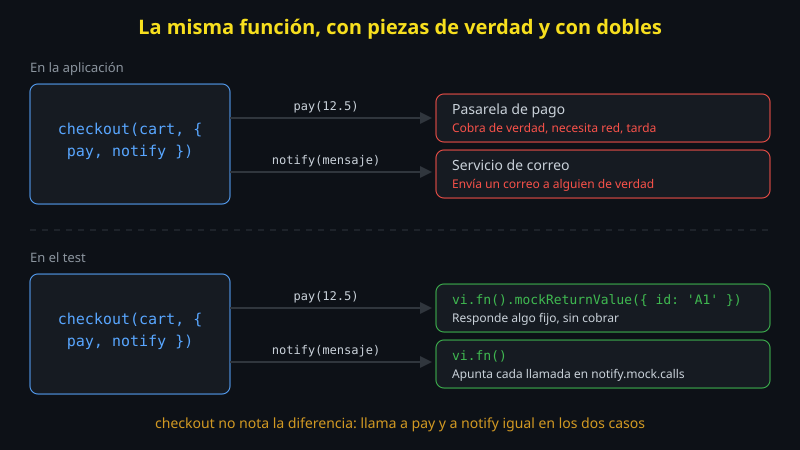

# 🎭 Dobles de prueba

## 🎯 Objetivos

- Explicar qué es un doble de prueba y por qué hace falta para probar código que depende de algo externo.
- Diseñar funciones que reciben sus dependencias, para poder pasarles un doble.
- Crear dobles con `vi.fn` y decidir qué devuelven con `mockReturnValue`, `mockResolvedValue` y `mockImplementation`.
- Comprobar cómo se llamó a un doble con `toHaveBeenCalledWith`, `toHaveBeenCalledTimes` y `mock.calls`.
- Sustituir lo que no recibes como parámetro con `vi.spyOn`, `vi.stubGlobal` y `vi.mock`, y deshacer el cambio después de cada test.

En la semana 25 todas las funciones eran puras: reciben datos y devuelven datos. Pero una aplicación también cobra, envía correos, pide datos a un servidor y mira la hora. Esas funciones no se pueden probar igual: no quieres cobrar de verdad en cada test, ni que un test falle porque hoy no hay red.

---

## 📋 Contenido

### 1. Qué es un doble de prueba

Un **doble de prueba** es una pieza falsa que ocupa el lugar de una de verdad durante un test, como el doble de un actor en una escena peligrosa. El código que pruebas no nota la diferencia: llama a la función de siempre, y el doble responde lo que el test le dijo.



Un doble hace dos trabajos:

| Trabajo | Para qué | Ejemplo |
|---|---|---|
| **Responder** algo fijo | Que el código siga su camino sin la pieza real | `pay` devuelve `{ id: 'A1' }` sin cobrar nada |
| **Apuntar** cómo lo llamaron | Comprobar que el código hizo lo que debía con su dependencia | `notify` guarda el mensaje que recibió |

En inglés verás muchos nombres: *mock*, *stub*, *spy*, *fake*. Los libros los distinguen por el trabajo que hacen; Vitest los llama a todos *mocks* y usa las mismas funciones para todo. En el curso decimos **doble** para el concepto y el nombre de Vitest para la función.

### 2. Recibir las dependencias

Un doble solo sirve si puedes ponerlo en el sitio de la pieza real. La forma más sencilla: que la función **reciba** sus dependencias como parámetros en lugar de buscarlas ella.

```js
// Difícil de probar: usa directamente la pasarela de pago.
import { chargeCard } from './payments.js';
export const checkout = (cart) => { /* ... */ chargeCard(total); /* ... */ };

// Fácil de probar: recibe pay y notify.
export const checkout = (cart, { pay, notify }) => { /* ... */ pay(total); /* ... */ };
```

En la aplicación le pasas la pasarela de verdad; en el test, un doble. Es la misma idea que separar `logic.js` de `main.js` desde la semana 05: la lógica no sabe de dónde vienen sus datos ni a dónde van sus resultados. Tiene un nombre: **inyección de dependencias**.

Un doble escrito a mano es una función de tres líneas ([lab 01, paso 1](../2-practicas/lab-01-dobles-de-prueba/README.md#paso-1-un-doble-escrito-a-mano)):

```js
const messages = [];
const notify = (message) => messages.push(message);
```

### 3. vi.fn

`vi.fn()` crea ese mismo doble sin escribirlo: una función que no hace nada, devuelve `undefined` y apunta cada llamada. Se importa `vi` de `vitest`, como `describe` o `expect`.

```js
import { vi } from 'vitest';

const pay = vi.fn().mockReturnValue({ id: 'A1' });
const notify = vi.fn();
```

**Qué devuelve.** Se configura encadenando métodos:

| Método | El doble... |
|---|---|
| `mockReturnValue(x)` | Devuelve `x` en cada llamada |
| `mockReturnValueOnce(x)` | Devuelve `x` solo en la siguiente llamada; se pueden encadenar varios |
| `mockResolvedValue(x)` | Devuelve una promesa que se cumple con `x`. Para dobles de funciones `async`, como `fetch` |
| `mockRejectedValue(error)` | Devuelve una promesa rechazada con `error` |
| `mockImplementation(fn)` | Hace lo que haga `fn`: calcular, lanzar un error... |

Los de promesas también tienen su versión `Once`: `mockResolvedValueOnce`, `mockRejectedValueOnce`.

**Cómo lo llamaron.** El doble guarda cada llamada en `doble.mock.calls`, un array con los argumentos de cada llamada: `[['Pedido A1: 12.50 €']]` es una llamada con un argumento. Los matchers de dobles leen ese registro:

| Matcher | Comprueba |
|---|---|
| `toHaveBeenCalled()` | Que se llamó al menos una vez |
| `toHaveBeenCalledTimes(n)` | Que se llamó exactamente `n` veces |
| `toHaveBeenCalledWith(a, b)` | Que alguna llamada recibió esos argumentos, comparados como `toEqual` |
| `toHaveBeenNthCalledWith(n, a)` | Los argumentos de la llamada número `n` (desde 1) |
| `toHaveBeenLastCalledWith(a)` | Los argumentos de la última llamada |

Con `not` delante, lo contrario: `expect(notify).not.toHaveBeenCalled()` comprueba que **no** se avisó, por ejemplo cuando el cobro falla.

### 4. vi.spyOn y vi.stubGlobal: lo que no recibes como parámetro

A veces la dependencia no es un parámetro: `Math.random`, `console.warn` o el `fetch` global. Para esos casos:

```js
// Cambia un método de un objeto por un espía.
vi.spyOn(Math, 'random').mockReturnValue(0.99);
const warn = vi.spyOn(console, 'warn').mockImplementation(() => {});

// Cambia una variable global entera.
vi.stubGlobal('fetch', vi.fn().mockResolvedValue(respuesta));
```

- `vi.spyOn(objeto, 'método')` pone un espía en el lugar del método. **Sin más, el espía llama al método de verdad** y solo apunta: así puedes contar las llamadas sin cambiar lo que pasa. Con `mockReturnValue` o `mockImplementation`, deja de llamarlo.
- `vi.stubGlobal(nombre, valor)` cambia una variable global (`globalThis.fetch`) por la que le des.

Estos cambios **no se deshacen solos**: el espía de un test sigue puesto en el siguiente ([lab 01, paso 4](../2-practicas/lab-01-dobles-de-prueba/README.md#paso-4-espiar-lo-que-no-recibes-como-parámetro)). Deshazlos en un `afterEach`, que se ejecuta después de cada test:

```js
afterEach(() => {
  vi.restoreAllMocks(); // los métodos espiados con vi.spyOn vuelven a ser los de verdad
  vi.unstubAllGlobals(); // las globales cambiadas con vi.stubGlobal, también
});
```

### 5. vi.mock: un módulo entero

Cuando la función importa su dependencia de otro módulo, ni parámetro ni objeto que espiar. `vi.mock` cambia el módulo entero:

```js
import { convert } from '../src/prices.js';
import { getRate } from '../src/rates.js';

vi.mock('../src/rates.js', () => ({
  getRate: vi.fn(),
}));
vi.mocked(getRate).mockReturnValue(1.1);
```

- El primer argumento es la ruta del módulo, la misma que en el `import`. El segundo, una función (la **fábrica**) que devuelve lo que exportará el módulo falso.
- Vitest **sube** cada `vi.mock` al principio del archivo, antes de los `import`, aunque lo escribas al final. Por eso `convert` ya recibe el doble al importar `rates.js`.
- Vale para **todo el archivo de test**. Si otro test del mismo archivo necesita el módulo de verdad, tiene que ir en otro archivo.

`vi.mock` resuelve cualquier caso, pero es la opción más difícil de seguir: el doble se define lejos de donde se usa y cambia lo que importan otros módulos sin que se vea. Úsalo cuando no puedas cambiar el código, por ejemplo con una librería. Si la función es tuya, el orden de preferencia es:

1. Que reciba la dependencia como parámetro (sección 2).
2. Si usa una global, `vi.stubGlobal` o `vi.spyOn`.
3. Si importa un módulo, `vi.mock`.

### 6. Lo que un doble no sabe

Un doble responde lo que tú le dijiste. Si te equivocas sobre cómo funciona la pieza real, el doble se equivoca contigo y el test pasa. En el [lab 03](../2-practicas/lab-03-tests-de-integracion/README.md#paso-2-el-doble-no-lo-sabía), un `fetch` falso aceptaba un `POST` sin cabecera que el servidor de verdad rechazaba. Los tests con dobles comprueban que tu código hace lo que **crees** que debe hacer con sus dependencias; que eso sea lo correcto lo comprueban los tests de integración ([teoría 03](03-tests-de-integracion.md)).

---

## 🧪 Pruébalo

El [lab 01](../2-practicas/lab-01-dobles-de-prueba/README.md) prueba `checkout` con dobles escritos a mano y con `vi.fn`, espía `Math.random` y `console.warn`, y cambia un módulo con `vi.mock`.

## ✅ Checklist de aprendizaje

- [ ] Explico qué es un doble de prueba y sus dos trabajos: responder y apuntar.
- [ ] Escribo funciones que reciben sus dependencias, y explico por qué son más fáciles de probar.
- [ ] Creo dobles con `vi.fn` y elijo entre `mockReturnValue`, `mockResolvedValue`, `mockRejectedValue` y `mockImplementation`.
- [ ] Compruebo cómo se llamó a un doble con `toHaveBeenCalledWith`, `toHaveBeenCalledTimes` y `mock.calls`.
- [ ] Uso `vi.spyOn`, `vi.stubGlobal` y `vi.mock`, y los deshago en un `afterEach`.

<!-- nav -->
---

## 🔗 Navegación

| Anterior | Siguiente |
|---|---|
| ← [Semana 26 - Testing con Vitest - Parte 2](../README.md) | [Teoría — ⏳ Tests asíncronos y reloj falso](02-tests-asincronos.md) → |

[↑ Semana 26](../README.md)
