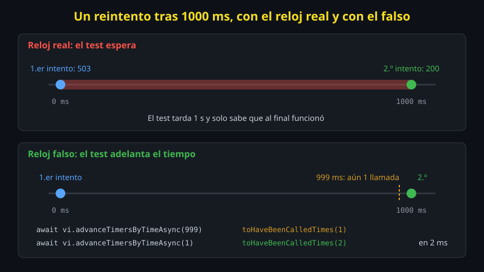

# ⏳ Tests asíncronos y reloj falso

## 🎯 Objetivos

- Escribir tests de funciones que devuelven promesas con `async`/`await`, `resolves` y `rejects`.
- Reconocer un test que termina antes que su comprobación, y evitarlo.
- Explicar por qué un test no debe esperar de verdad a un temporizador.
- Usar el reloj falso de Vitest: `vi.useFakeTimers`, `advanceTimersByTime`, sus versiones `Async`, `runAllTimersAsync` y `setSystemTime`.
- Comprobar cuánto espera una función y que no deja temporizadores vivos.

Pedir datos a un servidor, reintentar tras un fallo, esperar a que alguien deje de escribir o refrescar cada minuto: lo asíncrono de las semanas 13 a 16 y el `debounce` de la 23. Probarlo tiene dos problemas propios: el test tiene que **esperar** al resultado, y no puede esperar de verdad a los temporizadores.

---

## 📋 Contenido

### 1. Un test asíncrono

Si la función del test es `async`, Vitest espera a la promesa que devuelve antes de dar el test por terminado. Dentro, `await` como en cualquier función ([semana 14](../../week-14-async_await/README.md)):

```js
it('loadProduct devuelve el producto', async () => {
  const fetchFn = vi.fn().mockResolvedValue(respond(200, pen));

  const product = await loadProduct(7, fetchFn);

  expect(product).toEqual(pen);
});
```

El doble de `fetch` devuelve una promesa: `mockResolvedValue`. Y la respuesta falsa (`respond`) solo tiene lo que la función lee de una de verdad: `ok`, `status` y `json()`.

### 2. resolves

`expect(promesa).resolves` espera a que la promesa se cumpla y aplica el matcher a su valor. Ese `expect` devuelve también una promesa: **lleva `await` delante**.

```js
await expect(loadProduct(7, fetchFn)).resolves.toEqual(pen);
```

### 3. Promesas que fallan: rejects

`rejects` espera a que la promesa se rechace y comprueba el error con los matchers de siempre, como `toThrow`:

```js
await expect(loadProduct(7, fetchFn)).rejects.toThrow('Error 404 al cargar 7');
await expect(loadProduct(7, fetchFn)).rejects.toThrow(TypeError);
```

`toThrow` comprueba el mensaje o la clase del error. Para mirar otras propiedades, como el `status` de un error HTTP, recoge el error y compruébalo como un objeto:

```js
const error = await client.get(99).catch((reason) => reason);
expect(error).toBeInstanceOf(HttpError);
expect(error).toMatchObject({ status: 404 });
```

Cuando la promesa **no** se rechaza, `.catch` no recoge nada, `error` es el valor normal y `toBeInstanceOf` falla. El test sigue protegido.

### 4. El reloj falso

Una función que espera 1000 ms entre reintentos hace que su test tarde 1000 ms. Con cinco reintentos, cinco segundos, y Vitest corta cada test a los 5000 ms ([lab 02, paso 3](../2-practicas/lab-02-tests-asincronos/README.md#paso-3-esperar-de-verdad)). Bajar las esperas a 1 ms lo hace rápido, pero deja sin probar que la espera es la que toca.

`vi.useFakeTimers()` cambia `setTimeout`, `setInterval`, `Date` y compañía por versiones falsas. El tiempo **se para**: un temporizador solo se cumple cuando el test adelanta el reloj.



| Función | Qué hace |
|---|---|
| `vi.useFakeTimers()` | Pone el reloj falso. Desde aquí, el tiempo solo avanza a mano |
| `vi.advanceTimersByTime(ms)` | Adelanta `ms` y ejecuta los temporizadores que se cumplen por el camino |
| `vi.advanceTimersByTimeAsync(ms)` | Igual, y entre temporizador y temporizador deja que se resuelvan las promesas |
| `vi.runAllTimers()` / `vi.runAllTimersAsync()` | Ejecuta todos los temporizadores pendientes, también los que se crean mientras tanto |
| `vi.setSystemTime(fecha)` | Fija lo que devuelven `new Date()` y `Date.now()` |
| `vi.getTimerCount()` | Cuántos temporizadores quedan pendientes |
| `vi.useRealTimers()` | Devuelve el reloj de verdad |

**¿Con `Async` o sin?** Si el código mezcla temporizadores y promesas (`await wait(1000)` dentro de una función `async`), usa las versiones `Async`: después de cada temporizador, el código que espera a una promesa tiene que poder seguir antes de que se cumpla el siguiente. Si solo hay temporizadores (`debounce`), las normales bastan.

```js
it('loadWithRetry espera delay ms entre intentos', async () => {
  vi.useFakeTimers();
  const fetchFn = vi.fn().mockResolvedValueOnce(respond(503, {})).mockResolvedValueOnce(respond(200, pen));

  const promise = loadWithRetry(7, fetchFn);
  await vi.advanceTimersByTimeAsync(999);
  expect(fetchFn).toHaveBeenCalledTimes(1);
  await vi.advanceTimersByTimeAsync(1);
  expect(fetchFn).toHaveBeenCalledTimes(2);

  await expect(promise).resolves.toEqual(pen);
});
```

Y siempre, en un `afterEach`, el reloj de verdad:

```js
afterEach(() => {
  vi.useRealTimers();
});
```

**Una promesa que se va a rechazar** necesita alguien que la escuche **antes** de adelantar el reloj. Si no, se rechaza sin nadie que la recoja, y Vitest lo cuenta como error (`Unhandled Rejection`). Guarda la comprobación, adelanta y espera a la comprobación:

```js
const check = expect(loadWithRetry(7, fetchFn, { retries: 5 })).rejects.toThrow('Error 503 al cargar 7');
await vi.runAllTimersAsync();
await check;
```

### 5. Lo que el reloj falso te deja comprobar

Con el reloj de verdad solo sabes que la función terminó. Con el falso puedes comprobar **qué pasa en cada momento**:

- **Cuánto espera:** a los 999 ms no ha reintentado, al 1000 sí. Si alguien cambia la espera, el test falla.
- **Los bordes:** una caché que caduca «al cumplir» 60 s, comprobada en el segundo 59 y en el 60.
- **La hora:** `vi.setSystemTime(new Date(2026, 10, 23, 8, 59))` y la tienda está cerrada, sin esperar a que sean las 8:59.
- **Lo que queda pendiente:** `vi.getTimerCount()` después de que una función termine. Si es mayor que 0, ha dejado un temporizador vivo, una de las fugas de la [semana 23](../../week-23-performance_optimizacion/README.md).

### 6. El test que termina antes que su comprobación

Esto es lo más traicionero de los tests asíncronos:

```js
it('❌ sin await, el test no espera a la comprobación', () => {
  loadProduct(7, fetchFn).then((product) => {
    expect(product.name).toBe('lápiz');
  });
});
```

La función del test no espera a nada: deja el `.then` para luego y termina. Vitest da el test por bueno (`✓`) antes de que se ejecute el `expect`. En el [lab 02](../2-practicas/lab-02-tests-asincronos/README.md#paso-2-promesas-que-fallan), Vitest lo detecta por casualidad como `Unhandled Rejection`; con una respuesta más lenta, el fallo pasaría sin que nadie lo viera.

La regla: **si llamas a algo que devuelve una promesa, `await`**. Y si la función del test tiene `await`, es `async`. Con `resolves` y `rejects`, Vitest 5 te avisa si falta el `await`: el test falla con `Promise returned by expect(actual).rejects.toThrow(expected) was not awaited`.

---

## 🧪 Pruébalo

El [lab 02](../2-practicas/lab-02-tests-asincronos/README.md) prueba una carga con `resolves` y `rejects`, cae en el test sin `await`, espera de verdad hasta el límite de 5 s y pasa los mismos tests a reloj falso, con temporizadores y con la fecha.

## ✅ Checklist de aprendizaje

- [ ] Escribo tests `async` y uso `await` con `resolves` y `rejects`.
- [ ] Reconozco un test que termina antes que su comprobación y lo arreglo.
- [ ] Explico por qué un test no debe esperar de verdad a un temporizador.
- [ ] Uso `vi.useFakeTimers`, `advanceTimersByTime` y su versión `Async`, `runAllTimersAsync` y `setSystemTime`, y devuelvo el reloj con `vi.useRealTimers`.
- [ ] Compruebo cuánto espera una función y que no deja temporizadores pendientes con `vi.getTimerCount`.

<!-- nav -->
---

## 🔗 Navegación

| Anterior | Siguiente |
|---|---|
| ← [Teoría — 🎭 Dobles de prueba](01-dobles-de-prueba.md) | [Teoría — 🔌 Tests de integración](03-tests-de-integracion.md) → |

[↑ Semana 26](../README.md)
