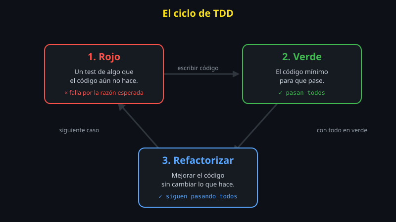

# 🔁 TDD

## 🎯 Objetivos

- Explicar el ciclo rojo, verde y refactorizar del TDD.
- Escribir el test antes que el código, y el código mínimo para que pase.
- Usar la triangulación para pasar de un caso concreto a la solución general.
- Refactorizar con los tests en verde, sin cambiar lo que hace el código.
- Decidir cuándo ayuda el TDD y cuándo no.

Hasta ahora has escrito los tests **después** del código: el código ya existía y los tests comprobaban que cumplía lo que prometía. **TDD** (*Test-Driven Development*, desarrollo guiado por tests) le da la vuelta: primero el test, después el código.

---

## 📋 Contenido

### 1. El ciclo

TDD se trabaja en ciclos cortos, de minutos, de tres fases:



1. **Rojo.** Escribe **un** test de algo que el código todavía no hace. Ejecútalo y comprueba que falla, y que falla por la razón esperada.
2. **Verde.** Escribe el código **mínimo** para que ese test pase, sin romper los anteriores.
3. **Refactorizar.** Con todo en verde, mejora el código (nombres, repeticiones, estructura) sin cambiar lo que hace. Ejecuta los tests después de cada cambio.

Y vuelta al rojo con el siguiente caso.

### 2. Por qué ver el rojo

Un test que nunca has visto fallar no sabes si funciona. Puede pasar porque el código es correcto o porque el test no comprueba nada: un `expect` sin matcher, un nombre de función mal escrito que da `undefined` en los dos lados, un test asíncrono sin `await`. Ver el rojo primero demuestra que el test **es capaz** de fallar.

Y que falle por la razón esperada. En el [lab 04](../2-practicas/lab-04-tdd/README.md#ciclo-1-el-caso-más-simple), el primer rojo es `expected undefined to be '0 s'`: la función no devuelve nada, como se esperaba. Si el rojo fuera un error de sintaxis o un `import` mal escrito, no estarías probando nada todavía.

### 3. El código mínimo

En el verde, escribe lo justo para que pase el test, aunque parezca trampa:

```js
// Ciclo 1: un test, '0 segundos son 0 s'.
export const formatDuration = (seconds) => {
  return '0 s';
};
```

Devolver un valor fijo no es la solución, y no pretende serlo. Con un solo test, nada pide más. El siguiente test (`45 segundos son 45 s`) obliga a usar `seconds`. Cada test nuevo descarta una solución falsa y empuja el código hacia la general. Se llama **triangulación**: como para situar un punto en un mapa hacen falta varias medidas, para llegar a la solución general hacen falta varios ejemplos.

¿Para qué ir tan despacio? Porque cada línea de código existe por un test que la pidió. Al terminar, no hay código sin probar ni casos sin decidir: el 100 % de cobertura sale solo.

### 4. Refactorizar en verde

Refactorizar es cambiar **cómo** está escrito el código sin cambiar **qué** hace. Los tests son la red: si siguen en verde después del cambio, el código hace lo mismo.

En el lab 04, después de las horas, el código repite tres veces el mismo patrón. El refactor lo cambia por una tabla de unidades y un bucle, y los 7 tests siguen en verde. En el ciclo siguiente, añadir los días es una línea de la tabla.

Dos reglas:

- **Refactoriza solo en verde.** Con un test en rojo, no sabes si lo que rompes es por el refactor o por lo que faltaba.
- **No añadas cosas al refactorizar.** Si se te ocurre un caso nuevo, apúntalo con `it.todo` y escríbelo en el siguiente rojo.

Los tests también se refactorizan: juntar casos repetidos en un `it.each`, mejorar un nombre. Con la misma regla: en verde, y sin cambiar lo que comprueban.

### 5. Cuándo ayuda y cuándo no

TDD ayuda sobre todo cuando:

- **Sabes qué debe hacer la función** pero no cómo escribirla: formatos, cálculos, validaciones, reglas de negocio. Los casos se escriben antes que el código.
- **Arreglas un error.** Primero un test que lo reproduce (rojo), después el arreglo (verde). Ese error ya no vuelve sin que lo veas.
- **La función tiene muchos casos límite.** Pensarlos uno a uno, como tests, hace que no se escape ninguno: en el lab 04, ¿qué pasa con `-1`? Escrito el código primero, es fácil no preguntárselo.

Y ayuda menos cuando:

- **Exploras.** Si todavía no sabes qué quieres (cómo se ve una página, qué API usar), prueba primero; los tests vienen cuando la idea se asienta.
- **El código es casi todo cableado:** colocar elementos en el DOM, llamar a una librería. Ahí aportan más los tests de integración.

No es todo o nada. Muchas personas trabajan con TDD en la lógica (`logic.js`) y escriben los tests de integración después.

---

## 🧪 Pruébalo

El [lab 04](../2-practicas/lab-04-tdd/README.md) escribe `formatDuration` con siete ciclos: cinco guiados, con el rojo, el código mínimo y un refactor, y dos que resuelves tú.

## ✅ Checklist de aprendizaje

- [ ] Explico las tres fases del ciclo y por qué hay que ver el rojo antes de escribir el código.
- [ ] Escribo el código mínimo para que pase un test, aunque sea un valor fijo.
- [ ] Uso varios ejemplos (triangulación) para llegar a la solución general.
- [ ] Refactorizo solo con los tests en verde, sin añadir cosas nuevas.
- [ ] Explico cuándo me ayuda TDD y cuándo prefiero escribir los tests después.

<!-- nav -->
---

## 🔗 Navegación

| Anterior | Siguiente |
|---|---|
| ← [Teoría — 🔌 Tests de integración](03-tests-de-integracion.md) | [Teoría — 🧭 Buenas prácticas](05-buenas-practicas.md) → |

[↑ Semana 26](../README.md)
