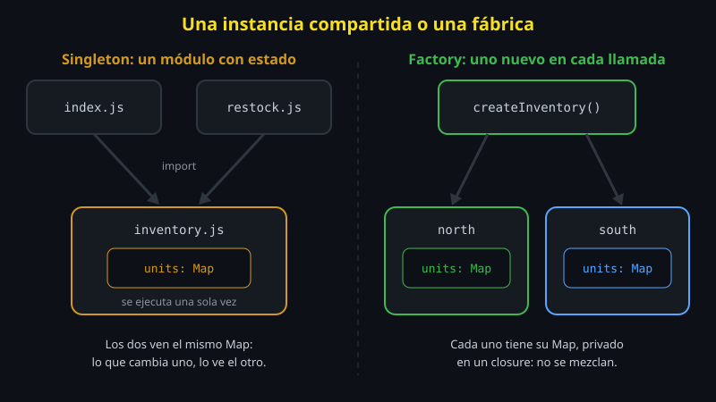

# 🧩 Module, Singleton y Factory

## 🎯 Objetivos

- Explicar qué es un patrón de diseño y para qué sirve ponerle nombre.
- Usar un módulo ES para separar lo público de lo privado.
- Reconocer un Singleton en un módulo con estado, y los problemas de compartirlo.
- Escribir funciones fábrica que crean objetos independientes, con datos privados en un closure.
- Escribir una fábrica que elige qué objeto crear según un tipo.

Un **patrón de diseño** es una solución conocida a un problema que se repite al escribir programas, con un nombre que todo el mundo entiende. No es código para copiar, sino una forma de organizarlo. Decir «aquí uso una fábrica» ahorra un párrafo de explicación en una revisión de código. Muchos patrones clásicos nacieron en lenguajes con clases; en JavaScript, varios se escriben con funciones y módulos, más cortos. Esta teoría trata los tres que deciden cómo se crean los objetos y quién los comparte.

---

## 📋 Contenido

### 1. Module: lo público y lo privado

El patrón **Module** agrupa en una unidad el código de un tema y decide qué se ve desde fuera. En JavaScript moderno no hace falta escribirlo: cada archivo con `import` y `export` es un módulo ([semana 4](../../week-04-destructuring_modulos_es2023/1-teoria/03-modulos-es6.md)). Lo que se exporta es su parte pública; lo demás es privado.

```js
// inventory.js
const units = new Map(); // privado
let changes = 0; // privado

const record = () => {
  changes += 1;
}; // privada

export const add = (name, amount) => {
  units.set(name, (units.get(name) ?? 0) + amount);
  record();
};

export const unitsOf = (name) => units.get(name) ?? 0;
export const changeCount = () => changes;
```

```js
import * as inventory from './inventory.js';
inventory.add('lápiz', 2);
console.log(Object.keys(inventory)); // [ 'add', 'changeCount', 'unitsOf' ]
console.log(inventory.units); // undefined
```

- **Qué:** solo `add`, `unitsOf` y `changeCount` salen del archivo. `units`, `changes` y `record` no existen para quien lo importa.
- **Para qué:** quien usa el inventario no puede dejar `units` en un estado imposible, como un `Map` con unidades negativas que nadie apuntó en `changes`. Todo cambio pasa por `add`.
- **Impacto:** la parte privada se puede cambiar (un objeto en lugar de un `Map`, por ejemplo) sin romper nada fuera, mientras las tres funciones públicas hagan lo mismo.

Antes de los módulos ES, el patrón se escribía con una función que se llamaba al momento y devolvía la parte pública (una *IIFE*). Lo verás en código antiguo; hoy, un archivo hace lo mismo.

### 2. Singleton: una sola instancia

Un **Singleton** es un objeto del que solo existe una instancia en todo el programa, y que todos comparten. En JavaScript, un módulo con estado ya lo es: Node y el navegador ejecutan cada módulo **una sola vez**, la primera vez que alguien lo importa, y todos los `import` siguientes reciben el mismo objeto.

```js
// restock.js
import { add } from './inventory.js';
export const restock = (name) => add(name, 10);
```

```js
restock('lápiz'); // otro módulo cambia el inventario
console.log(inventory.unitsOf('lápiz')); // 15: los 5 de antes y los 10 de restock
const again = await import('./inventory.js');
console.log(again === inventory); // true
```



Una sola instancia tiene sentido cuando lo que representa es único de verdad: la configuración que se lee al arrancar, la conexión a una base de datos, el registro de errores. Para todo lo demás tiene dos problemas:

- **Estado compartido:** cualquier módulo puede cambiarlo, y cuando algo falla no sabes quién fue. Es una variable global con otro nombre.
- **Tests que dependen unos de otros:** el estado sobrevive de un test al siguiente, el error del [lab 03 de la semana 25](../../week-25-testing_vitest_parte_1/2-practicas/lab-03-organizar-tests/README.md#paso-2-tests-que-dependen-unos-de-otros). No hay forma de pedir un inventario vacío.

### 3. Factory: una función que crea objetos

Una **función fábrica** (*factory function*) es una función normal que crea y devuelve un objeto. Cada llamada crea uno nuevo, con sus propios datos.

```js
export const createInventory = () => {
  const units = new Map(); // privado de este inventario
  let changes = 0;
  return {
    add: (name, amount) => {
      units.set(name, (units.get(name) ?? 0) + amount);
      changes += 1;
    },
    unitsOf: (name) => units.get(name) ?? 0,
    changeCount: () => changes,
  };
};

const north = createInventory();
const south = createInventory();
north.add('lápiz', 2);
south.add('lápiz', 7);
console.log(north.unitsOf('lápiz'), south.unitsOf('lápiz')); // 2 7
console.log(north.units); // undefined
```

- **Qué:** `units` y `changes` son variables locales de `createInventory`. Las funciones del objeto devuelto las recuerdan después de que `createInventory` termine: es un **closure**, como el temporizador del `debounce` de la [semana 23](../../week-23-performance_optimizacion/1-teoria/02-debounce-throttle.md).
- **Para qué:** dos tiendas, dos inventarios; cada test, uno nuevo. Y los datos siguen siendo privados, como en el módulo.
- **Impacto:** es la forma más habitual de crear objetos en este bootcamp: `createStock`, `createCache`, `createPoller`. El nombre empieza por `create` para que se lea como lo que es.

Una clase con campos privados (`#count`, [semana 3](../../week-03-clases_programacion_orientada_objetos/1-teoria/05-campos-privados.md)) consigue lo mismo. La diferencia práctica está en `this`:

```js
class Counter {
  #count = 0;
  increment() {
    this.#count += 1;
    return this.#count;
  }
}
const createCounter = () => {
  let count = 0;
  return { increment: () => (count += 1) };
};

const { increment } = createCounter();
increment(); // 1: no depende de this
const { increment: broken } = new Counter();
broken(); // TypeError: Cannot read properties of undefined (reading '#count')
```

Un método de una clase depende del objeto que lo llama; si lo sacas del objeto (para pasarlo como *callback*, por ejemplo), pierde su `this`. Las funciones de una fábrica no usan `this`. Las clases tienen ventajas propias, como la herencia con `extends` o `instanceof`; elige una forma por proyecto y no las mezcles sin motivo.

### 4. Factory que elige qué crear

El patrón **Factory**, en su sentido clásico, es una función que decide **qué tipo** de objeto crear. Quien la llama pide un tipo y recibe un objeto con la interfaz de siempre, sin saber cómo se construye.

```js
const BUILDERS = {
  email: ({ to }) => ({ kind: 'email', send: (text) => `Correo a ${to}: ${text}` }),
  sms: ({ to }) => ({ kind: 'sms', send: (text) => `SMS a ${to}: ${text.slice(0, 160)}` }),
  console: () => ({ kind: 'console', send: (text) => `[aviso] ${text}` }),
};

export const createNotifier = (kind, options = {}) => {
  const build = BUILDERS[kind];
  if (!build) throw new Error(`No hay avisadores de tipo «${kind}»`);
  return build(options);
};

for (const notifier of [createNotifier('email', { to: 'ana@tienda.test' }), createNotifier('console')]) {
  console.log(notifier.send('Quedan 2 lápices'));
}
// Correo a ana@tienda.test: Quedan 2 lápices
// [aviso] Quedan 2 lápices
```

- El bucle llama a `send` sin preguntar de qué tipo es cada avisador: todos tienen el mismo método.
- El tipo llega como texto (de un formulario, de la configuración), y la fábrica es el único sitio del programa que sabe qué objeto le corresponde.
- Un tipo nuevo es una entrada más en `BUILDERS`. Un tipo que no existe da un error claro en el momento de crearlo, no un `undefined` tres funciones más allá.

### 5. Cuándo usar cada uno

| Necesitas | Patrón | En JavaScript |
|---|---|---|
| Esconder los detalles de un tema y dejar una interfaz pequeña | Module | Un archivo con `export` |
| Una sola cosa para todo el programa (configuración, conexión) | Singleton | Un módulo con estado, o un objeto creado una vez y exportado |
| Varias instancias independientes, con datos privados | Factory | Una función `createX` que devuelve un objeto |
| Crear un objeto u otro según un dato | Factory que elige | Un objeto de constructores y una función que busca en él |

Un patrón se usa cuando resuelve un problema que tienes, no para que el código parezca profesional. Una fábrica para un objeto que solo se crea una vez y no se prueba aparte es código de más.

---

## 🧪 Pruébalo

El [lab 01](../2-practicas/lab-01-module-singleton-factory/README.md) recorre los cuatro casos con un inventario: el módulo, la instancia que comparten dos archivos, lo que no puedes hacer con ella y las dos fábricas.

## ✅ Checklist de aprendizaje

- [ ] Explico qué es un patrón de diseño y por qué tener nombres comunes ayuda.
- [ ] Separo lo público de lo privado con `export` en un módulo.
- [ ] Explico por qué un módulo con estado es un Singleton y qué problemas da en los tests.
- [ ] Escribo una función fábrica con datos privados en un closure.
- [ ] Escribo una fábrica que elige qué crear con un objeto de constructores.

<!-- nav -->
---

## 🔗 Navegación

| Anterior | Siguiente |
|---|---|
| ← [Semana 27 - Patrones de Diseño y Clean Code](../README.md) | [Teoría — 📣 Observer y Strategy](02-observer-strategy.md) → |

[↑ Semana 27](../README.md)
