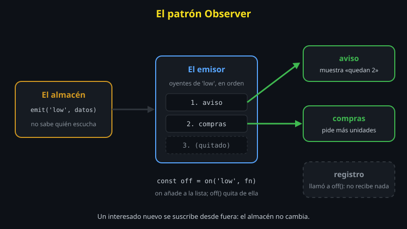

# 📣 Observer y Strategy

## 🎯 Objetivos

- Explicar el patrón Observer: quien emite no sabe quién escucha.
- Escribir un emisor de eventos con `on`, `emit` y una función para dejar de escuchar.
- Reconocer el Observer que ya traen JavaScript y el navegador: `EventTarget`.
- Cambiar un `switch` que elige un comportamiento por un objeto de estrategias.

Los patrones de la teoría 01 deciden cómo se crean los objetos. Estos dos deciden cómo se comunican y cómo se elige un comportamiento, y los dos sirven para lo mismo: que añadir algo nuevo no obligue a cambiar lo que ya funciona.

---

## 📋 Contenido

### 1. El problema: un objeto que conoce a todos

Un almacén que, cuando a un producto le quedan pocas unidades, avisa a quien le interesa:

```js
take: (name, amount) => {
  const left = (units.get(name) ?? 0) - amount;
  units.set(name, left);
  if (left < LOW_STOCK) {
    showWarning(name, left); // la interfaz
    orderMore(name); // compras
    sendEmail(name); // el encargado
  }
},
```

El almacén conoce a tres módulos que no tienen nada que ver con guardar unidades. Cada interesado nuevo es un cambio en `take`, y para probar el almacén necesitas tres dobles.

### 2. Observer: emitir sin saber quién escucha

En el patrón **Observer**, un objeto emite **eventos** y otros se suscriben a los que les interesan. El que emite no conoce a nadie: llama a la lista de funciones suscritas, sea cual sea.



```js
export const createEmitter = () => {
  const listeners = new Map(); // nombre del evento → Set de funciones

  const on = (name, listener) => {
    if (!listeners.has(name)) listeners.set(name, new Set());
    listeners.get(name).add(listener);
    return () => listeners.get(name).delete(listener); // dejar de escuchar
  };

  const emit = (name, data) => {
    for (const listener of listeners.get(name) ?? []) listener(data);
  };

  return { on, emit };
};
```

```js
const alerts = createEmitter();
const stock = createStock(alerts); // recibe el emisor; dentro, solo hace alerts.emit('low', { name, left })
alerts.on('low', ({ name, left }) => console.log(`aviso: ${name}, quedan ${left}`));
stock.add('lápiz', 10);
stock.take('lápiz', 8);
// aviso: lápiz, quedan 2
```

- **Qué:** `on` apunta una función en la lista de un evento; `emit` llama a todas las de ese evento con el dato, en el orden en que se suscribieron. Un evento sin oyentes no hace nada.
- **Para qué:** el almacén solo sabe emitir `'low'`. Un interesado nuevo se suscribe desde fuera, y `createStock` no cambia.
- **Impacto:** `on` devuelve la función que deja de escuchar. Un oyente que no se quita sigue vivo mientras viva el emisor, y con él todo lo que recuerda: es una de las fugas de memoria de la [semana 23](../../week-23-performance_optimizacion/1-teoria/04-fugas-memoria.md).

El precio del Observer es que el camino del código ya no se lee de arriba abajo: al leer `emit('low')` no sabes qué pasará. Úsalo cuando los interesados cambien o no los conozcas al escribir el emisor, no para conectar dos funciones que siempre van juntas.

### 3. El Observer de JavaScript: EventTarget

El navegador usa el patrón Observer en todos sus eventos: `addEventListener` es `on`, y `dispatchEvent` es `emit` ([semana 18](../../week-18-event_handling_avanzado/1-teoria/04-acciones-eventos-propios.md)). `EventTarget`, la clase de la que heredan los elementos del DOM, también existe sola, en el navegador y en Node:

```js
const target = new EventTarget();
const controller = new AbortController();
target.addEventListener('sale', (event) => console.log('caja:', event.detail.total, '€'), {
  signal: controller.signal,
});
target.addEventListener('sale', () => console.log('primera venta del día'), { once: true });
target.dispatchEvent(new CustomEvent('sale', { detail: { total: 12 } }));
// caja: 12 €
// primera venta del día
controller.abort(); // quita el primer oyente
```

`once: true` se quita solo tras la primera vez, y `signal` quita al oyente cuando se llama a `abort()`. Con un emisor propio decides tú la interfaz y el dato llega tal cual; con `EventTarget` el dato va dentro de `event.detail`, pero es estándar y no hay que escribirlo ni probarlo.

### 4. Strategy: un objeto en lugar de un switch

Un `switch` que elige qué cálculo hacer según un dato es habitual:

```js
export const shippingCostSwitch = (method, weight) => {
  switch (method) {
    case 'standard':
      return 4 + weight * 0.5;
    case 'express':
      return 9 + weight;
    case 'locker':
      return 3;
    default:
      throw new Error(`Método de envío desconocido: ${method}`);
  }
};
```

Funciona, pero para añadir un método hay que abrir la función y cambiarla, y el mismo `switch` suele repetirse en otros sitios (el nombre del método, el plazo de entrega). En el patrón **Strategy**, cada comportamiento es una función, y se guardan en un objeto con el dato como clave:

```js
export const SHIPPING = {
  standard: (weight) => 4 + weight * 0.5,
  express: (weight) => 9 + weight,
  locker: () => 3,
};

export const shippingCost = (method, weight) => {
  const strategy = SHIPPING[method];
  if (!strategy) throw new Error(`Método de envío desconocido: ${method}`);
  return strategy(weight);
};

SHIPPING.pickup = () => 0; // un método nuevo, sin tocar shippingCost
console.log(shippingCost('pickup', 2)); // 0
```

- **Qué:** cada estrategia tiene la misma forma (recibe el peso y devuelve el coste), así que `shippingCost` las usa todas igual.
- **Para qué:** un método nuevo es una línea en `SHIPPING`. `shippingCost` no cambia y sus tests tampoco.
- **Impacto:** las estrategias se prueban por separado, y la lista de métodos posibles es `Object.keys(SHIPPING)`, útil para un `<select>`.

Ya lo has usado sin el nombre: la función de comparación que recibe `toSorted` es una estrategia de orden, y `BUILDERS` en la fábrica de la teoría 01 es un objeto de estrategias de construcción.

### 5. Cuándo merece la pena

| Señal en el código | Patrón |
|---|---|
| Una función llama a módulos que no tienen que ver con su trabajo para avisarles | Observer |
| Los interesados en algo cambian, o los añade quien usa tu código | Observer |
| Un `switch` o una cadena de `if` elige qué cálculo hacer según un dato | Strategy |
| El mismo `switch` sobre el mismo dato aparece en varias funciones | Strategy |

Con dos casos que no van a cambiar, un `if` es más claro que cualquiera de los dos patrones.

---

## 🧪 Pruébalo

El [lab 02](../2-practicas/lab-02-observer-strategy/README.md) usa un emisor, lo mete dentro de un almacén, compara con `EventTarget` y cambia el `switch` del envío por estrategias.

## ✅ Checklist de aprendizaje

- [ ] Explico el patrón Observer y por qué el emisor no conoce a sus oyentes.
- [ ] Escribo un emisor con `on`, `emit` y la función para dejar de escuchar, y explico por qué hay que llamarla.
- [ ] Uso `EventTarget` y `CustomEvent` con `once` y `signal`.
- [ ] Cambio un `switch` por un objeto de estrategias y añado una sin tocar la función que las usa.
- [ ] Explico cuándo un `if` es mejor que cualquiera de los dos patrones.

<!-- nav -->
---

## 🔗 Navegación

| Anterior | Siguiente |
|---|---|
| ← [Teoría — 🧩 Module, Singleton y Factory](01-module-singleton-factory.md) | [Teoría — ✨ Clean code](03-clean-code.md) → |

[↑ Semana 27](../README.md)
