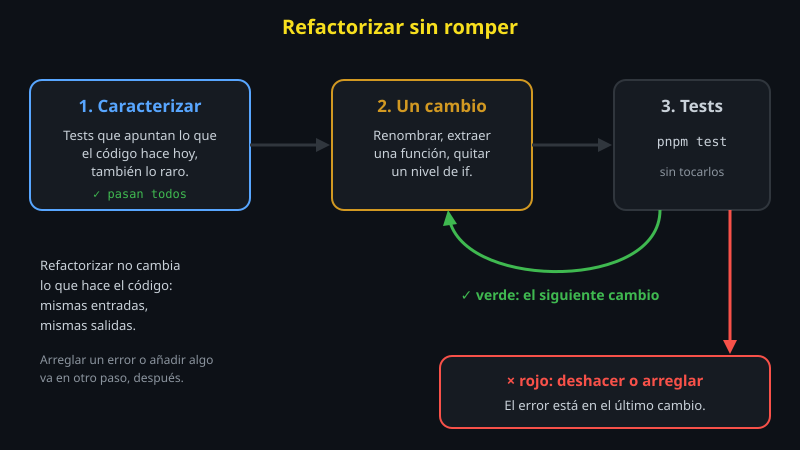

# 🔧 Code smells, refactorizar y herramientas

## 🎯 Objetivos

- Reconocer los *code smells* más comunes y el refactor que suele arreglar cada uno.
- Refactorizar sin cambiar lo que hace el código: tests de caracterización y pasos pequeños.
- Usar ESLint para encontrar errores y aplicar límites de clean code.
- Usar Prettier para no discutir nunca más sobre el formato.

Las teorías 01 a 04 dicen cómo debería ser el código. Casi nunca empiezas desde cero: lo habitual es heredar código que funciona y que nadie quiere tocar. Esta teoría trata cómo mejorarlo sin romperlo, y las dos herramientas que vigilan que no vuelva a empeorar.

---

## 📋 Contenido

### 1. Code smells

Un **code smell** (olor del código) es una señal de que algo puede estar mal diseñado. No es un error: el código funciona. Es un aviso de que el próximo cambio va a costar más de lo que debería.

| Olor | Cómo se reconoce | Refactor habitual |
|---|---|---|
| Función larga | No cabe en pantalla; tiene comentarios que separan partes | Extraer funciones con nombre |
| Nombres que no dicen nada | `d`, `tmp`, `data2`, `calc` | Renombrar |
| Lista larga de parámetros | `report(d, t, s, desc, min, cb)` | Un objeto de opciones |
| Parámetro booleano | `calc(lines, coupon, true)` | Dos funciones |
| Anidamiento profundo | Tres o más niveles de `if` y bucles | Cláusulas de guarda, extraer funciones |
| Números mágicos | `0.1`, `4.95`, `86400` sueltos | Constantes con nombre |
| Código duplicado | La misma regla copiada en varias funciones | Extraer y llamar desde todas |
| `switch` repetido | El mismo `switch` sobre el mismo dato en varios sitios | Objeto de estrategias |
| Estado global | Variables de módulo que todos cambian | Una fábrica; recibir el estado |
| Código muerto | Funciones o variables que nadie usa, código comentado | Borrarlo (git lo recuerda) |

### 2. Refactorizar es no cambiar lo que hace

**Refactorizar** es cambiar la estructura del código **sin cambiar lo que hace**: mismas entradas, mismas salidas, mismos efectos. Si además arreglas un error o añades algo, ya no es un refactor, y cuando algo falle no sabrás cuál de los dos cambios fue. Primero se refactoriza, con los tests en verde; después, en otro paso, se cambia el comportamiento.

El problema del código heredado es que no suele tener tests, y sin tests no sabes si lo has cambiado. La salida son los **tests de caracterización**: tests que apuntan lo que el código hace **hoy**, también lo que parece raro.

```js
it('un pedido vacío cuesta el envío', () => {
  expect(calc([])).toBe(4.95);
});
```

Cobrar 4.95 € por un pedido vacío seguramente es un error. Pero el test lo apunta tal cual: puede que algún código dependa de ello, y arreglarlo es una decisión aparte. Si cambia durante el refactor, el test lo dice.



Con los tests en verde, se avanza en **pasos pequeños**: renombrar, ejecutar; extraer una función, ejecutar; cambiar un `if`, ejecutar. Si un test falla, el error está en el último cambio, que es pequeño: se deshace o se arregla en un momento. Diez cambios seguidos sin ejecutar los tests convierten un fallo en una búsqueda.

Una forma de escribir los tests de caracterización cuando el código es grande: llamar a la función vieja y a la nueva con muchos datos distintos y comprobar que dan lo mismo. Es lo que hacen los tests del [proyecto](../3-proyecto/README.md).

### 3. ESLint: encontrar errores antes de ejecutar

**ESLint** es un *linter*: lee el código sin ejecutarlo y avisa de lo que incumple sus reglas. Se instala en el proyecto con pnpm, con versión exacta, como Vitest:

```bash
pnpm add --save-dev --save-exact eslint@10.14.0
```

Su configuración es `eslint.config.js`, un módulo que exporta una lista de objetos: a qué archivos se aplica cada uno y qué reglas activa.

```js
export default [
  {
    files: ['**/*.js'],
    languageOptions: { globals: { console: 'readonly' } },
    rules: {
      'no-undef': 'error', // una variable que no existe
      'no-unused-vars': 'error', // algo que se declara y no se usa
      eqeqeq: 'error', // === en lugar de ==
      'prefer-const': 'error',
      complexity: ['error', 4], // como mucho 4 caminos por función
      'max-depth': ['error', 2], // como mucho 2 bloques anidados
      'max-params': ['error', 3],
    },
  },
];
```

Con un script `"lint": "eslint ."` en el `package.json`, `pnpm lint` revisa todo el proyecto. Una salida real, del [lab 04](../2-practicas/lab-04-eslint-prettier/README.md):

```text
   3:7   error  'DEBUG' is assigned a value but never used                          no-unused-vars
  13:34  error  Expected '===' and instead saw '=='                                 eqeqeq
  22:5   error  'totl' is not defined                                               no-undef
  30:7   error  Blocks are nested too deeply (3). Maximum allowed is 2              max-depth
  43:8   error  Function 'label' has too many parameters (4). Maximum allowed is 3  max-params
```

- **Qué:** cada línea es `línea:columna`, el problema y la regla. `'totl' is not defined` es una errata que, sin ESLint, solo aparece al ejecutar esa función.
- **Para qué:** las reglas de errores probables (`no-undef`, `no-unused-vars`, `eqeqeq`) encuentran fallos de verdad; las de límites (`complexity`, `max-depth`, `max-params`, `max-lines-per-function`) convierten los olores de la tabla en avisos automáticos.
- **Impacto:** `pnpm lint --fix` arregla solo lo que tiene un arreglo seguro, como `let` por `const`. Lo demás lo decides tú.

ESLint trae un conjunto de reglas recomendadas en el paquete `@eslint/js`. En este bootcamp las reglas se escriben una a una: así ves qué hace cada una, y `@eslint/js` no tiene ahora una versión que cumpla la regla de versiones de [stack-versions](../../../docs/stack-versions.md). Cuando una regla tiene una excepción justificada, `// eslint-disable-next-line regla -- motivo` la desactiva para la línea siguiente. Si se usa a menudo, la regla no encaja con el proyecto: cámbiala en la configuración.

### 4. Prettier: el formato, de una vez

**Prettier** es un formateador: reescribe el código con un formato fijo (sangría, comillas, punto y coma, saltos de línea), sin cambiar lo que hace. Casi no tiene opciones, a propósito: el equipo deja de discutir sobre espacios.

```bash
pnpm add --save-dev --save-exact prettier@3.10.0
```

```json
{
  "singleQuote": true,
  "printWidth": 100
}
```

- `.prettierrc.json` guarda las pocas opciones: comillas simples, como todo el bootcamp, y líneas de 100 caracteres como mucho.
- `prettier --check .` dice qué archivos no tienen el formato; `prettier --write .` los reescribe.
- `.prettierignore` lista lo que no se toca, con el formato de `.gitignore`. `pnpm-lock.yaml` va ahí: lo escribe pnpm, y si Prettier lo cambia, el siguiente `pnpm install` lo vuelve a escribir.

ESLint y Prettier no se pisan si no activas en ESLint sus reglas de formato (`semi`, `indent`, `quotes`), que están obsoletas desde la versión 8.53 y han pasado al paquete aparte `@stylistic/eslint-plugin`. ESLint decide si el código es correcto y claro; Prettier, cómo se ve.

### 5. Cuándo ejecutarlos

Las dos herramientas valen poco si se ejecutan a mano de vez en cuando. Lo habitual:

- **En el editor**, con sus extensiones: los avisos de ESLint salen subrayados mientras escribes, y Prettier formatea al guardar.
- **Un script que lo junta todo**, como `"check": "eslint . && prettier --check . && vitest run"`, antes de cada commit.
- **En la integración continua**, el mismo script en cada *pull request*: el código que no lo pasa no entra.

---

## 🧪 Pruébalo

El [lab 03](../2-practicas/lab-03-refactorizar-con-tests/README.md) refactoriza una función con tests de caracterización, y uno de sus pasos rompe un test a propósito. El [lab 04](../2-practicas/lab-04-eslint-prettier/README.md) instala ESLint y Prettier y arregla todo lo que encuentran.

## ✅ Checklist de aprendizaje

- [ ] Reconozco los olores de la tabla y sé qué refactor arregla cada uno.
- [ ] Explico qué es refactorizar y por qué no se mezcla con arreglar errores.
- [ ] Escribo tests de caracterización antes de refactorizar código sin tests.
- [ ] Configuro ESLint con reglas de errores y de límites, y leo su salida.
- [ ] Configuro Prettier, con su archivo de ignorados, y distingo su trabajo del de ESLint.

<!-- nav -->
---

## 🔗 Navegación

| Anterior | Siguiente |
|---|---|
| ← [Teoría — 🧱 SOLID](04-solid.md) | [Índice de labs](../2-practicas/README.md) → |

[↑ Semana 27](../README.md)
